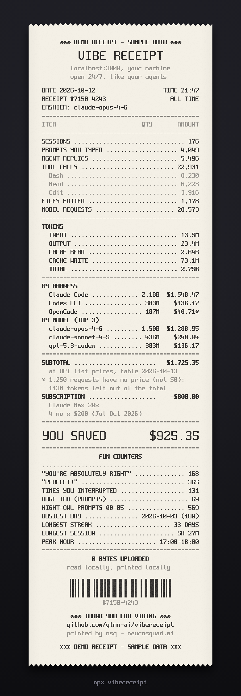
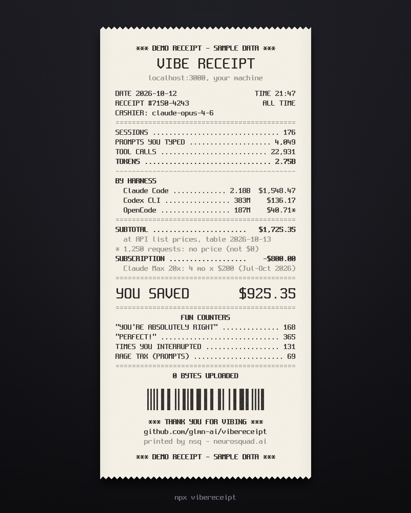

# vibereceipt

**Print a store receipt for your AI coding. Tokens, what they'd cost at API prices, and how many times the agent said "You're absolutely right".**

```sh
npx vibereceipt
```

(Or straight from GitHub: `npx github:glmn-ai/vibereceipt`.)

<p align="center">
  
</p>

<p align="center"><sub>The receipt above comes from <code>--demo</code> sample data, not a real person's logs.</sub></p>

Posting it? `--short` prints a compact receipt and saves it as an exact 4:5 PNG,
which the X timeline shows uncropped:

<p align="center">
  
</p>

vibereceipt reads the session logs that Claude Code, Codex CLI and OpenCode
already keep on your machine. It prints a thermal-printer receipt in your
terminal, line by line, and saves a PNG of it that's ready to post. It needs
no account, makes no network calls and uploads nothing.

## What's on the receipt

- **Header**: date, time, a receipt number (a hash of the stats), and the
  "cashier", which is your top model by cost.
- **Items**: sessions, prompts you typed, agent replies, tool calls (with the
  top 3 tools), files edited, and model requests.
- **Tokens**: input, output, cache read, cache write and the total.
- **By harness and by model** (top 3): tokens and cost for each.
- **Total at API list prices**, with the date of the price table. With
  `--plan`, you also get your subscription for the same months and either
  **YOU SAVED** or **YOU OVERPAID**, whichever is true.
- **Fun counters**, each shown only when the logs have it:
  - "You're absolutely right" and "Perfect!", counted in the agent's replies
  - times you interrupted the agent
  - **rage tax**: prompts containing wtf / fuck / shit / damn
  - night-owl prompts sent between 00:00 and 05:00
  - your busiest day
  - your longest streak of consecutive days
  - your longest session
  - your peak hour
- **Footer**: `0 BYTES UPLOADED`, a decorative barcode, and a thank-you.

## Usage

```sh
npx vibereceipt                # all time
npx vibereceipt --since 30d    # or 7d, 4w, 6m, 1y, 2026-09-01
npx vibereceipt --month        # this calendar month
npx vibereceipt --plan max20   # compare with your subscription
npx vibereceipt --short        # compact 4:5 receipt for the timeline
npx vibereceipt --demo         # sample data, clearly marked DEMO
```

| Flag | What it does |
| --- | --- |
| `--since <when>` | Period: `30d`, `7d`, `4w`, `6m`, `1y`, or a date `YYYY-MM-DD` (local time). The default is all time. |
| `--month` / `--year` | This calendar month or year. |
| `--plan <plan>` | `pro` ($20), `max5` ($100), `max20` ($200), `chatgpt-plus` ($20), `chatgpt-pro` ($200), or any monthly price, e.g. `100` or `$49.99`. |
| `--short` | A compact receipt for posting: header; sessions, prompts and tool calls; total tokens; cost by harness; subtotal or plan comparison; the top 4 fun counters; footer. The PNG is an exact 4:5. |
| `--out <path>` | Where to save the PNG. The default is `./vibereceipt-YYYY-MM-DD.png`. |
| `--no-png` | Don't save a PNG. |
| `--no-anim` | Print the receipt instantly. Output that isn't a TTY never animates. |
| `--no-color` | No ANSI styling. `NO_COLOR` is respected too. |
| `--json` | Print the stats as JSON instead of the receipt. Money is given in exact picodollars plus a dollar string. No PNG is saved unless you pass `--out`. |
| `--projects` | Add your top 3 project folder names, as base names only. Off by default. |
| `--demo` | Print a receipt made from built-in sample data. It says DEMO at the top and bottom. |
| `-h`, `--help` / `-v`, `--version` | Show help or the version. |

After the receipt prints, you get the path to the PNG and a ready-made
**Share on X** link. The link fills in the text only, so attach the PNG
yourself.

## What it reads

| Harness | Where |
| --- | --- |
| Claude Code | `$CLAUDE_CONFIG_DIR/projects`, otherwise `~/.claude/projects` and `~/.config/claude/projects`. Subagent logs are included. |
| Codex CLI | `$CODEX_HOME/sessions` and `archived_sessions`, otherwise `~/.codex/…` |
| OpenCode | `$XDG_DATA_HOME/opencode/opencode.db`, otherwise `~/.local/share/opencode/opencode.db` (the same path on Windows and macOS) |

OpenCode keeps its history in SQLite, which vibereceipt reads with Node's
built-in `node:sqlite` in **read-only** mode. That module needs Node 22.13 or
newer. On older Node versions, OpenCode is skipped with a note and everything
else still works on Node 18.17 and up.

If no logs are found, vibereceipt lists every place it looked.

## Privacy

- **No network.** vibereceipt has zero runtime dependencies and never
  imports `http`, `https`, `net`, `tls` or `dgram`, and never calls `fetch`.
  You can check for yourself:

  ```sh
  grep -rnE "fetch\(|node:https?|node:net|node:tls|node:dgram|WebSocket" dist   # prints nothing
  ```

  The only URLs in `dist/` are text: the share link it prints and the
  two price-table source URLs kept as plain strings. Every CI run repeats
  this check.
- **Read-only.** Logs are only ever opened for reading, and the OpenCode
  database is opened with `readOnly: true`. The only file vibereceipt writes
  is the PNG.
- **Nothing private goes on the receipt.** Prompt text is reduced to a
  timestamp and a yes/no "rage" flag the moment it's read, and replies are
  reduced to phrase counts. Edited file paths are used only to count distinct
  files. MCP and unknown tools are grouped together, so private server or tool
  names never appear. Project folder names show up only with `--projects`.
  A test feeds the scanners fixture logs full of marker strings and fails if
  any of them reaches the receipt or the JSON.

## How the cost is computed

The parsers and the pricing are vendored from
[`@neurosquad/core`](https://github.com/glmn-ai/neurosquad-cli), the engine
behind nsq:

- **Requests are de-duplicated.** Claude Code writes one line per content
  block, and resumed or forked sessions copy earlier messages. Lines are merged
  by message id, so every API request is counted once. Codex uses its
  per-response `token_usage_record`. OpenCode uses one row per assistant step.
- **Exact money.** Token counts are integers, and prices are integers in
  micro-dollars per million tokens. Cost is calculated in integer picodollars
  with no floating point and rounded once, for display.
- **Each token type has its own price.** Uncached input, output (reasoning
  included, never charged twice), cache reads, 5-minute and 1-hour cache
  writes, OpenAI long-context pricing (above 272K input tokens), Anthropic fast
  mode, the 1.1x `inference_geo: us` multiplier and web searches are all
  priced separately.
- **The price table is versioned.** The receipt prints the table's date
  (`price table 2026-10-13`). The prices are Anthropic's and OpenAI's
  published API list prices.
- **Unknown models are "no price", never $0.** A local model, a model behind a
  reseller, or a model missing from the table gets no price. The receipt shows
  how many requests and tokens that covers, and a `*` marks rows that are only
  partly priced. When the table has no price for a request but the harness
  recorded a cost of its own (OpenCode computes one from its provider
  catalogue), that recorded cost is used. A recorded cost of 0 counts as no
  price.

**Caveats:**

- This is what the same traffic **would cost at API list prices**. A Claude or
  ChatGPT subscription isn't billed per token, so the total isn't what you
  paid.
- The logs don't say who paid. If `ANTHROPIC_API_KEY` (or an OpenAI key for
  Codex) was set, those requests were billed to the API, not your plan, and
  `--plan`'s "you saved" doesn't apply to them.
- How `--plan` counts the subscription, printed on the receipt:
  - a period of fixed length is charged for its length: `--since 30d` is one
    30-day month (`30 days = 1 mo x $100`), `--since 7d` is 7/30 of one,
    `--since 6m` six, `--month` one;
  - all time and `--year` are charged once per **calendar month touched**,
    from your first activity to your last, e.g. `4 mo x $200 (Jul-Oct 2026)`.
- Counters come from what the logs record:
  - "Prompts you typed" leaves out tool results, slash-command plumbing,
    system and meta lines, and prompts a parent agent sent to a subagent.
  - A "longest session" is the longest stretch of one session without a
    1-hour gap.
  - Codex interrupts are its `turn_aborted: interrupted` events. OpenCode
    interrupts are aborted assistant messages.
  - OpenCode 2's new tables are read for usage but not yet for the fun
    counters.
- Big numbers are rounded for display (`2.75B`). `--json` has every exact value.

## Supported harnesses

- Claude Code
- Codex CLI
- OpenCode

Want another one? The parsers come from `@neurosquad/core`, which already
reads more harnesses. Open an issue.

## Development

```sh
npm install
npm run build      # TypeScript -> dist/ (committed, so npx github:… works without a build step)
npm test           # node:test, synthetic Claude/Codex/OpenCode fixtures
npm run demo       # regenerates assets/receipt-demo.png
```

`dist/` is committed on purpose, and CI fails if it's out of date. The vendored
parsers in `src/vendor/neurosquad-core/` are a read-only copy: fixes go
upstream first, then get re-vendored. Each file's header names the upstream
commit it was copied from.

## Credits

- Parsers from [@neurosquad/core](https://github.com/glmn-ai/neurosquad-cli),
  the engine behind nsq (github.com/glmn-ai/neurosquad-cli). MIT.
- The receipt is set in [Spleen](https://github.com/fcambus/spleen) by Frederic
  Cambus (BSD 2-Clause, see `fonts/LICENSE-spleen` and `NOTICE`).
- "Claude Code", "Codex" and "OpenCode" are named only to say whose logs are
  read. vibereceipt isn't affiliated with Anthropic, OpenAI or the OpenCode
  project.

MIT © NeuroSquad. Printed by nsq · [neurosquad.ai](https://neurosquad.ai)
